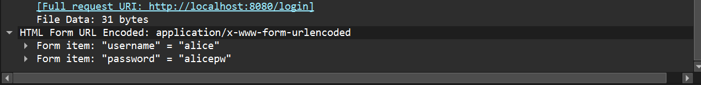
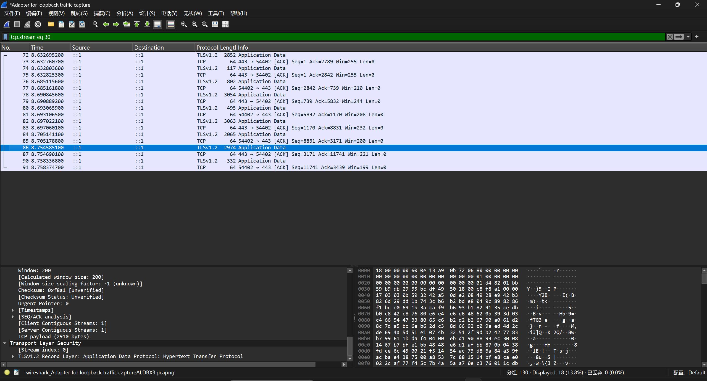
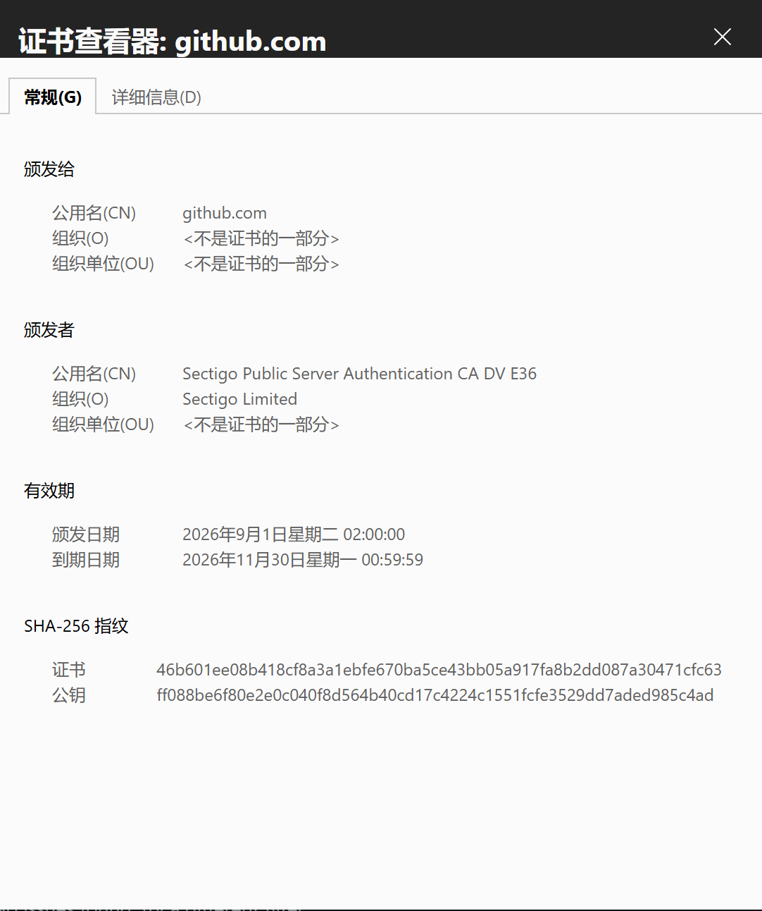
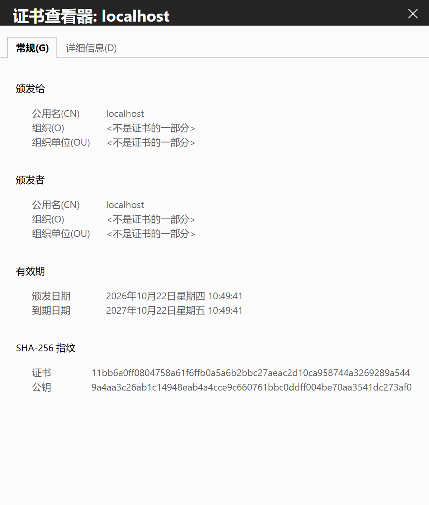
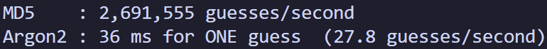
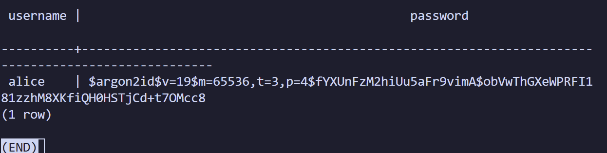

# NotesApp Security Audit

**Class 5 — Labs 1 and 2**

**Name 1:** Siyuan Wu

**Name 2:** Congwen Liu

**Date:** 22 October 2026

## Lab 1 — HTTP, HTTPS and certificate trust

### Finding 1 — Login over plain HTTP

We logged in at `http://localhost:8080/login` and captured our own loopback traffic using Wireshark with `tcp.port == 8080 and http`. Packet **188**, `POST /login HTTP/1.1`, contained:

```text
username=alice&password=alicepw
```

Packet **190** returned `302 FOUND`, followed by a request to `/dashboard`.

- **Exposed:** The account username and password in readable form.
- **Who can read it:** Someone able to observe the HTTP traffic, including an on-path attacker or someone with local capture access.
- **Severity:** **High** on an untrusted network, because the password could be captured and reused.
- **Fix:** Require HTTPS and remove direct access to the plaintext login endpoint.



*Figure 1. The HTTP request exposes the login fields.*

### HTTPS re-test

For `https://localhost`, the capture shows traffic on port **443**. With `tcp.stream eq 30`, packet **86** is displayed as TLS **Application Data**. Its payload contains encrypted bytes rather than a readable HTTP form.

**Password readable?** No plaintext username or password is visible in the displayed TLS payload. This packet view shows encryption on the observed connection; it does not document a full-stream password search or verify closure of port 8080.



*Figure 2. TLS application data in the HTTPS capture.*

### Finding 2 — Certificate trust

| Field | GitHub | Local NotesApp |
| --- | --- | --- |
| Subject / common name | `github.com` | `localhost` |
| Issuer / common name | Sectigo Public Server Authentication CA DV E36 | `localhost` |
| Type | CA-issued | Self-signed for the lab |



*Figure 3. GitHub's certificate names Sectigo as its issuer.*



*Figure 4. The local certificate has localhost as both subject and issuer.*

**Trust our certificate lacks:** It has no chain to a publicly trusted certificate authority. Without separately establishing trust, the browser cannot authenticate its claimed server identity automatically. These screenshots show the subject and issuer, not a full chain validation.

**Verdict:** Encryption protects traffic from passive reading; trusting the server also requires certificate and identity verification.

## Lab 2 — Password storage

### Finding 1 — Unsalted MD5

- **Cracked:** **4 / 6 in 0.175 ms** in the local repeat, using the course's public wordlist. The recovered passwords were `123456`, `iloveyou`, `qwerty123` and `password1`.
- **Why those fell:** All four passwords appeared in the wordlist; hashing each guess produced a matching MD5 value.
- **Held out:** marie (`mariepw`) and raj (`Gv7#pLm2!xQ`) were absent from this list. Marie's password remains predictable; surviving one list does not make it strong.
- **Severity:** **High**, because fast, unsalted MD5 makes offline guessing of common passwords very cheap after a leak.
- **Fix:** Use salted Argon2id and upgrade legacy passwords after a correct login.

The MD5 dump contains six fictional lab accounts. The actual NotesApp originally stored plaintext passwords, which the login fix now migrates to Argon2id. An earlier result displayed `0.0 ms`; this does not mean execution took literally zero time.

### Finding 2 — The fix, measured

The original benchmark screenshot gives:

| Algorithm | Guesses / second | Estimated guesses / day |
| --- | ---: | ---: |
| MD5 | 2,691,555 | 232,550,352,000 |
| Argon2 | 27.8 | 2,401,920 |

Argon2 is about **96,819 times slower per guess** using these displayed rates. Daily estimates use guesses/second × 86,400.



*Figure 5. Original benchmark: approximately 36 ms per Argon2 hash.*

After rebuilding locally, a repeat measured **2,982,587 MD5 guesses/second** and **16.8 Argon2 guesses/second**, or 59.6 ms per Argon2 hash. Both runs are single-process lab estimates; timings and attacker throughput depend on hardware and implementation.

**Verdict:** Argon2 increases the time and memory cost of each guess. It makes offline attacks more expensive, but weak passwords may still be guessed.

### Migration verification



*Figure 6. Database screenshot showing Alice's password stored as Argon2id.*

Local testing confirmed that Alice's correct login upgraded her plaintext password. Logging out and logging in again succeeded, including through `https://localhost`. Wrong passwords, unknown users and malformed hashes were rejected. All **13 application checks** and **3 HTTPS checks** passed, and the temporary test account was removed. Details are in the [local verification results](local_verification.txt).

## Final state

NotesApp runs over HTTPS with a self-signed lab certificate. Alice is migrated to Argon2id; other legacy accounts upgrade on their next correct login. Argon2id uses 64 MiB memory, three passes and four lanes. The HTTPS login checks used this self-signed certificate with certificate validation disabled. Other planted vulnerabilities remain outside these two labs.

References: [Lab 1 — HTTPS](https://kristenpire.github.io/epita-security-labs/class5/https-lab/), [Lab 2 — Password audit](https://kristenpire.github.io/epita-security-labs/class5/password-audit/).
