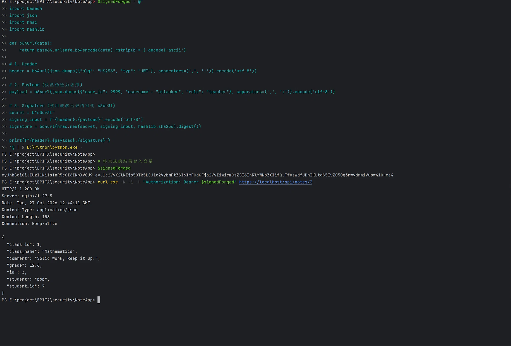

# NotesApp JWT Forgery — Part 1 & 2

**Name:** Siyuan Wu

**Date:** 27 October 2026

**Status:** Part 1 and Part 2 completed.

## Finding 1 — unsigned JWT accepted (`alg: none`)

| Item | Result |
| --- | --- |
| What I read | Bob's Mathematics grade, **12.6**, and comment, **“Solid work, keep it up.”**, through `/api/notes/3`. |
| How | Sent a Bearer JWT with `alg: none`, `user_id: 9999`, `username: attacker`, `role: teacher`, and an empty signature. |
| Why it worked | The server's verification logic accepts `alg: none` and returns the supplied payload without checking a signature. The API then accepts this forged identity. |

The request with the forged token returned **HTTP 200 OK** and Bob's note.
A request to the same endpoint without an Authorization header returned
**HTTP 401 UNAUTHORIZED**, with `{"error":"unauthorized"}`.
Neither curl request supplied a login password or a session cookie.

## Finding 2 — weak HS256 secret allows signature forgery

| Item | Result |
| --- | --- |
| What I read | Bob's Mathematics grade (**12.6**) and comment again, via `/api/notes/3`. |
| How | Assuming the server now rejects `alg: none`, I guessed the weak secret `s3cr3t`. Using this secret, I generated a valid HMAC-SHA256 signature for a forged teacher payload (`role: teacher`). |
| Why it worked | The server relies on a weak, easily guessable secret to sign JWTs. Even if the `alg: none` vulnerability is patched, an attacker can still forge a cryptographically valid token if the secret is compromised. |

The request with the properly signed forged token returned **HTTP 200 OK** and Bob's note.

This demonstrates acceptance of a forged API identity. The API also has a separate
access-control flaw: it does not check who owns the requested note. The result does
not establish access to every teacher-only page. No authentication code was changed
for this exercise; the course schedules the fixes for a later class.

## Key Takeaways
To properly secure JWT authentication, the server must implement three defenses:
1. **Reject `alg: none`**: A token with no signature must never be accepted.
2. **Pin the algorithm**: The server must explicitly enforce the expected algorithm (e.g., HS256) and ignore the `alg` header provided by the client.
3. **Use a long, random secret**: The secret key must be at least 256 bits (64 random hex characters) to prevent brute-force attacks.

Source: [Class 6 — Forge a token](https://kristenpire.github.io/epita-security-labs/class6/forge-a-token/)