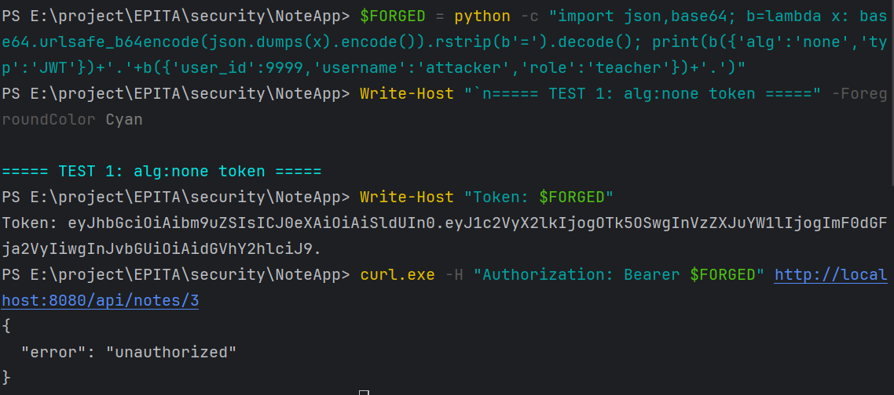
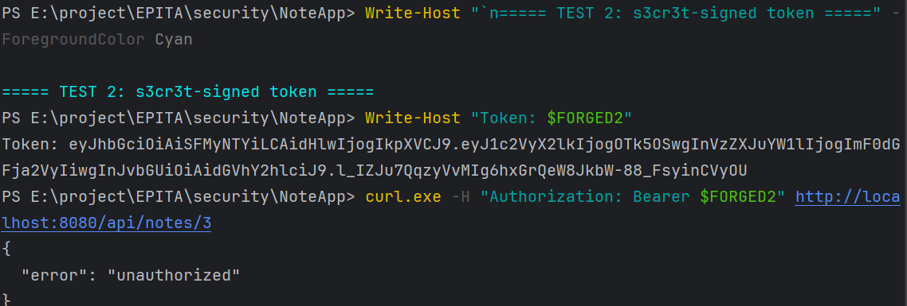
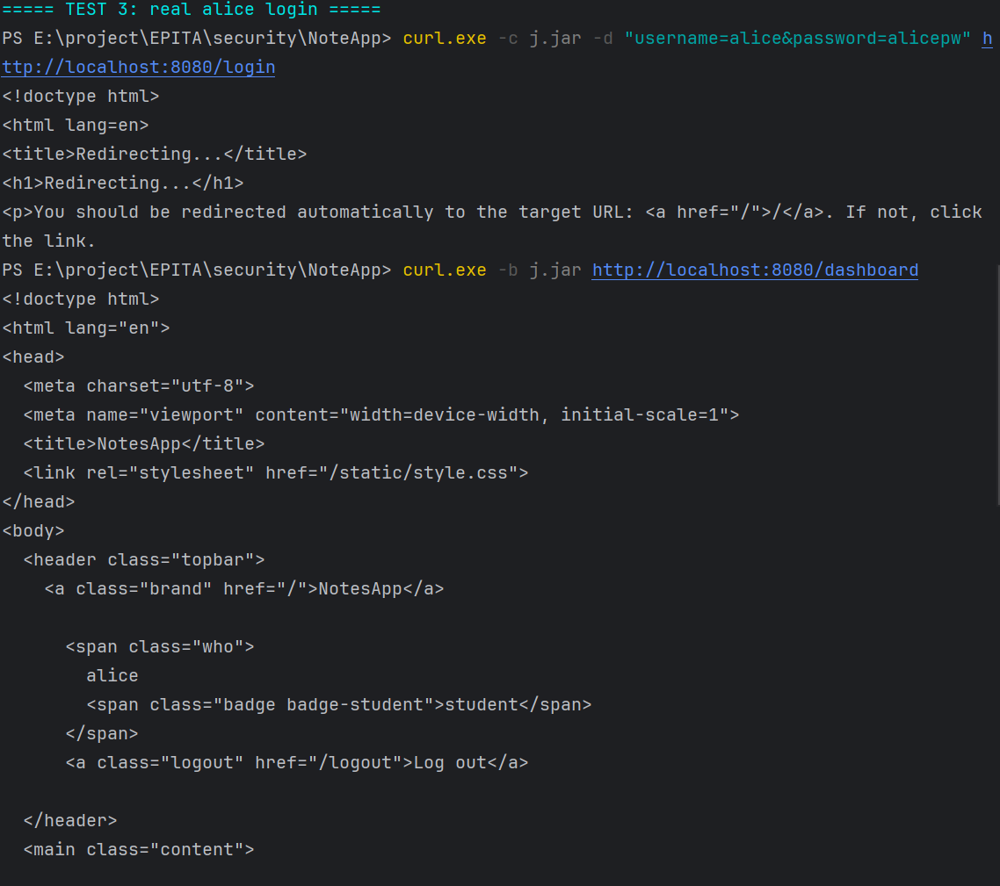
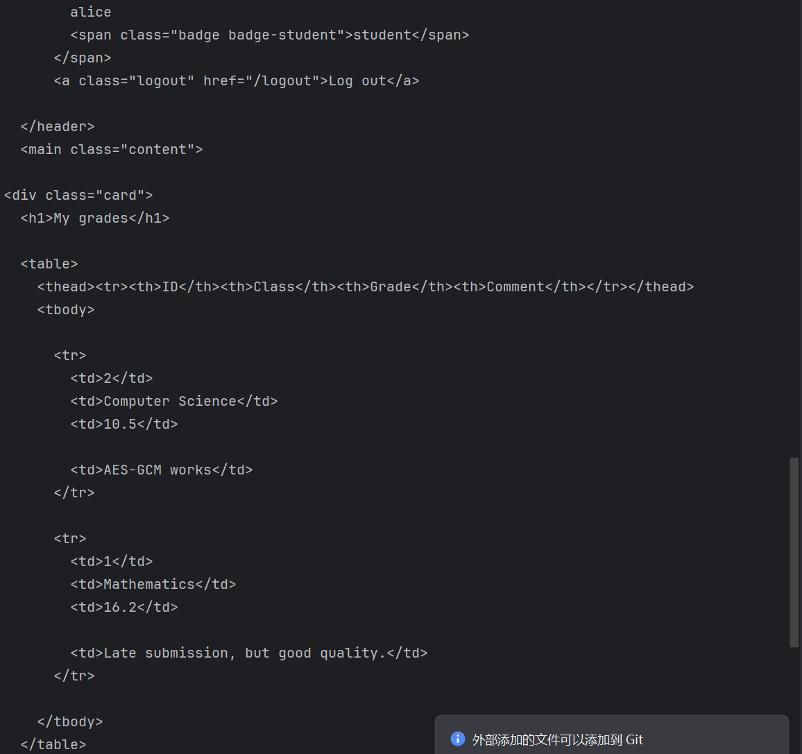

# LOGIN FIX — NotesApp flaw #4

**Name:** Siyuan Wu  
**Test date:** 30 October 2026

- **Fix 1:** `verify_jwt` rejects `alg:none` and accepts only HS256, checking the signature with `hmac.compare_digest`.
- **Fix 2:** `JWT_SECRET` was replaced with a long random value and is read from the environment without a default.
- **Proof:**
  - Unsigned `alg:none` token → `unauthorized`.
  - Token signed with the old `s3cr3t` secret → `unauthorized`.
  - Real Alice login → succeeds; the dashboard displays Alice’s grades.

