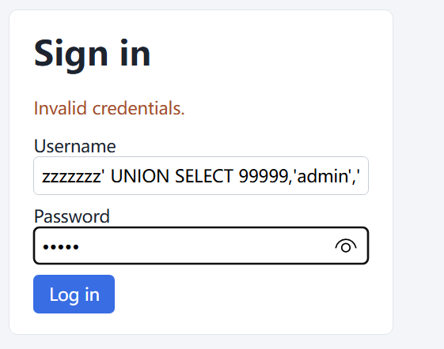
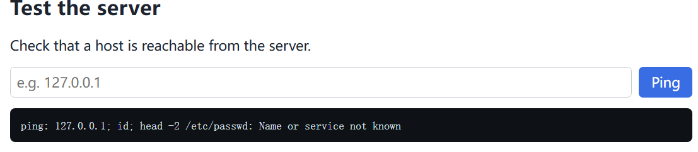
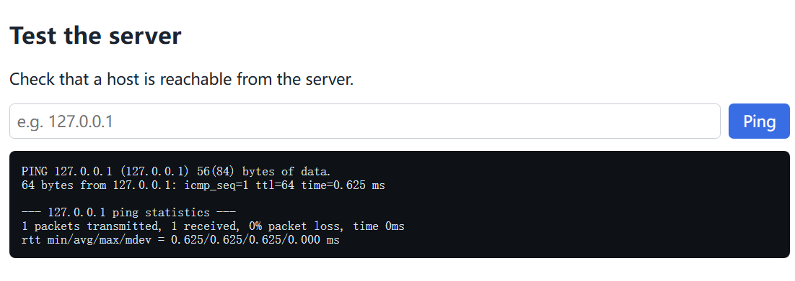

# Class 9 — NoteApp injection fixes

**Name:** Siyuan Wu

**Test date:** 17 November 2026

**Fix commit:** `<commit-hash>` (`Parameterise the login query; remove shell=True from admin ping`)

## Before the fix

### SQL injection in `login()`

The login handler built its query by concatenating the submitted username
directly into the SQL string:

```python
query = (
    "SELECT id, username, role, password FROM users "
    "WHERE username = '" + username + "'"
)
```

Password verification happens afterwards in Python, not in the SQL `WHERE`
clause, so the textbook payload `admin' -- ` only closes the username blank
early — it does not bypass the password check. I used a `UNION` payload
instead, forging a full row (including a plaintext password of my choosing)
so the request matched NoteApp's plaintext-comparison branch rather than its
Argon2 branch.

| Request | HTTP status | Result |
| --- | --- | --- |
| `username=admin' -- `, `password=anything` | 200 | "Invalid credentials." — the query ran, but the real password check still failed |
| `username=zzzzzzz' UNION SELECT 99999,'admin','admin','hax0r' -- `, `password=hax0r` | 302 → `/` | Authenticated as `admin` from a forged row; no real password used |

Requesting `/admin` with the resulting session cookie returned HTTP 200 and
the admin dashboard, confirming the forged login was accepted as an
administrator. This is NoteApp flaw #8.

*Note: NoteApp's session cookie stores the role at login time and is not
re-checked against the database on every request, so this forged session
remained valid for the command-injection test below and for the fix
verification afterwards.*

### Command injection in `admin_ping()`

The admin ping handler built a shell command by concatenating the submitted
host directly into a string and ran it with `shell=True`:

```python
cmd = "ping -c 1 " + host
subprocess.run(cmd, shell=True, capture_output=True, text=True, timeout=10)
```

| Request (as forged admin) | Output |
| --- | --- |
| `host=127.0.0.1; id; head -2 /etc/passwd` | `uid=0(root) gid=0(root) groups=0(root)`, followed by the first two lines of `/etc/passwd` |

The shell read the semicolon as a command separator, so `id` and `head` ran
as a second and third command after the ping. This is NoteApp flaw #9.

## Fix

### SQL injection

[`login()`](../../web/app.py) now passes the username as a bound parameter
instead of concatenating it into the query string:

```python
query = "SELECT id, username, role, password FROM users WHERE username = %s"
cur.execute(query, (username,))
```

The database driver treats `username` as data, never as SQL grammar, so a
quote or `--` in the input can no longer change the query.

### Command injection

[`admin_ping()`](../../web/app.py) now calls `subprocess.run` with an
argument list and no shell:

```python
result = subprocess.run(
    ["ping", "-c", "1", host],
    capture_output=True, text=True, timeout=10,
)
```

`host` is passed as a single argument straight to `ping`; there is no shell
left to reinterpret `;`.

## After the fix

I rebuilt the web service and repeated the same requests.

| Caller / request | Observed result |
| --- | --- |
| `username=admin' -- ` | HTTP 200, "Invalid credentials." |
| `username=zzzzzzz' UNION SELECT 99999,'admin','admin','hax0r' -- ` | HTTP 200, "Invalid credentials." |
| `alice` login with her real password | HTTP 302 → `/`, dashboard loads normally |
| Admin ping, `host=127.0.0.1; id; head -2 /etc/passwd` | `ping: 127.0.0.1; id; head -2 /etc/passwd: Name or service not known` — no `id` or `/etc/passwd` output |
| Admin ping, `host=127.0.0.1` | Normal ping statistics, 1 packet transmitted / received |

Both injection payloads are now inert, and the real login and ping use cases
are unaffected.

### Screenshots



The UNION payload used before the fix now returns "Invalid credentials."



The same host payload no longer runs `id` or reads `/etc/passwd`; ping fails
to resolve the whole string as a hostname instead.



A plain `127.0.0.1` still pings successfully, confirming the fix does not
break real use.

Lab instructions: [Class 9 — Your words become commands](https://kristenpire.github.io/epita-security-labs/class9/injection/).
